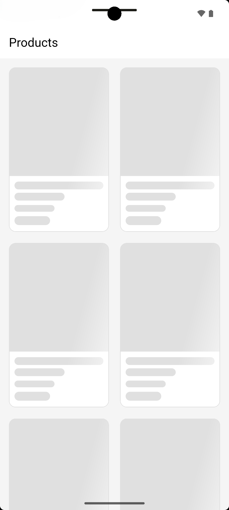
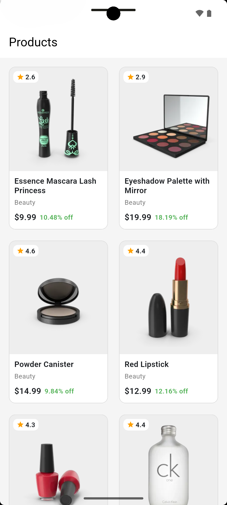
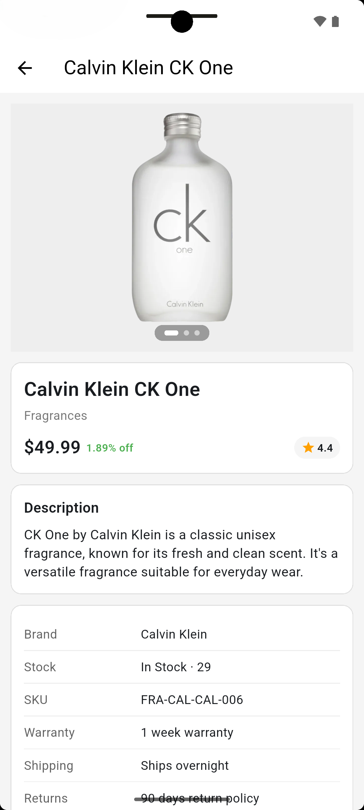

# Product App

Machine test app. Shows products from DummyJSON and opens a details page when you tap one.

API: https://dummyjson.com/docs/products

## Setup

Need Flutter 3.12+.

```bash
flutter pub get
dart run build_runner build --delete-conflicting-outputs
flutter run
```

`*.g.dart` files are gitignored, so run build_runner after clone.

## Test execution

```bash
flutter test
```

Tests use fake repositories. They do not call the live API.

## Architecture overview

Clean architecture with feature folders.

```
lib/
  core/          # dio, get_it, router, shared widgets
  features/
    products/
      data/          # retrofit api, shared_preferences cache, repository
      domain/        # entities, repository contract, use cases
      presentation/  # blocs + list/details screens
    splash/
```

Screen flow:

Splash (3 sec) -> Product list -> Product details

Tap a product opens details with `go_router` and passes the product as extra so the page shows immediately. Details API runs in parallel to refresh data.

UI -> bloc -> use case -> repository -> DummyJSON.  
On API failure, repository returns cached data if we have it.

## Screenshots

### Splash


### Product list loading


### Product list


### Product details

